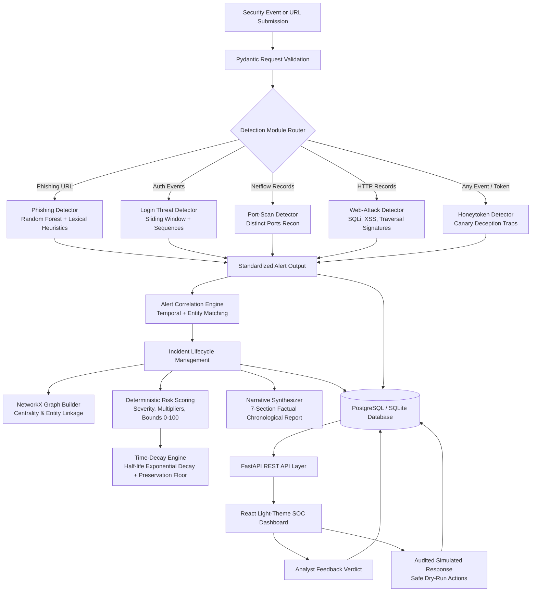
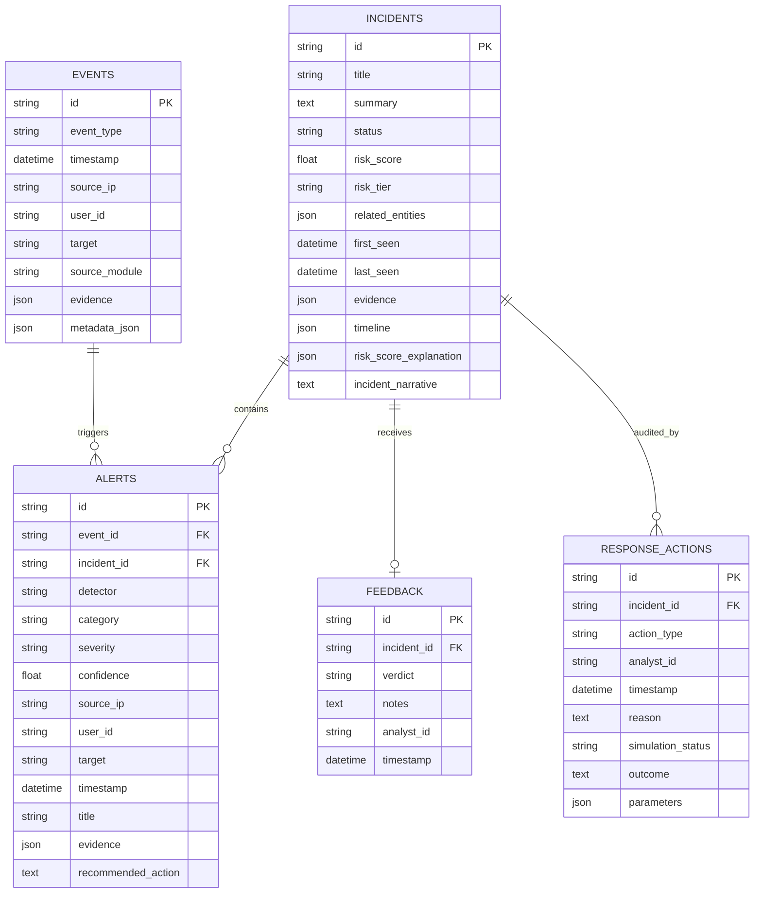

# System Architecture & Technical Design

## 1. End-to-End Event Pipeline

The following diagram illustrates the active, fully integrated data pipeline implemented across the platform:

---

## 2. Database Schema and Relationships

Persistence is implemented via SQLAlchemy with transactional support across PostgreSQL (Docker) and SQLite (Local development):

---

## 3. Intelligence and Correlation Strategy

### 3.1 Baseline Evidence Correlation
Incoming alerts are evaluated against open/investigating incidents within a configurable temporal window (`CORRELATION_WINDOW_SECONDS = 1800`):
1. **Temporal Proximity**: Alert timestamp must fall within 30 minutes of the incident's active range.
2. **Entity Matching**:
   - Shared attacker source IP address.
   - Shared targeted user account or employee identifier.
   - Shared canary honeytoken or deception trap identifier.
   - Shared target host or URL resource (with secondary entity confirmation).
3. **Deduplication**: Identical alert signatures within active suppression windows are deduplicated to prevent incident flooding.

### 3.2 Graph-Assisted Correlation & IP Rotation
Attackers routinely rotate egress IP addresses (VPNs, Tor, proxies) to evade simple perimeter IP bans. NetworkX multi-graph intelligence constructs entity relationships:
- **Nodes**:
  - `ip`: Egress network origin
  - `user`: Targeted user account
  - `target`: Victim infrastructure
  - `honeytoken`: Seeded canary secret
  - `alert`: Standardized detection finding
- **Edges**: Evidence-backed interactions (`AUTHENTICATED_AS`, `COMMUNICATED_WITH`, `TARGETED`, `ACCESSED_CANARY`, `TRIGGERED`).
- **Rotation Linkage**: When an attacker rotates from IP A to IP B, graph traversal connects IP A → User X → IP B via the common authentication attempt and shared honeytoken, merging them into a unified multi-stage campaign.

---

## 4. Risk Scoring & Half-Life Decay

### 4.1 Bounded Risk Function (0 to 100)
- **Base Severity Weights**:
  - Critical: `40.0`
  - High: `25.0`
  - Medium: `15.0`
  - Low: `5.0`
- **Diminishing Returns**: Repeated alerts from the same detector module are weighted with diminishing multipliers (1st: `1.0`, 2nd: `0.5`, 3rd+: `0.2`) to prevent score inflation from spam.
- **Corroboration Multipliers**:
  - Honeytoken trigger: `+25.0` (high certainty adversary action).
  - Multi-stage sequence (Recon + Credential Access/Exploit): `+12.0`.
  - Multi-detector corroboration (3+ modules): `+15.0`.
- **Risk Tiers**:
  - `0 - 29`: Low
  - `30 - 59`: Medium
  - `60 - 84`: High
  - `85 - 100`: Critical

### 4.2 Time-Decay Model
Stale evidence contributions decay exponentially over time according to half-life:
$$\text{DecayFactor} = 2^{-\frac{\Delta t}{\tau}}$$
where $\Delta t$ is elapsed hours and $\tau = 24.0$ hours.
- **Critical Evidence Protection Floor**: High-confidence honeytokens and critical indicators are protected by a minimum preservation floor (score floor $\ge 40.0$), ensuring that serious adversary history is never silently erased.

---

## 5. Safe Response Architecture

The automated response system enforces non-destructive dry-run execution:
- Supported prototype actions:
  - `SIMULATE_BLOCK_IP`: Simulates firewall rule addition (`iptables -A INPUT -s ... -j DROP`).
  - `SIMULATE_DISABLE_ACCOUNT`: Simulates IAM directory account disablement.
  - `CONTAIN_INCIDENT`: Updates status to contained and logs quarantine event.
  - `INVESTIGATE_INCIDENT`: Spawns forensic ticket and updates workflow status.
  - `RESET_HONEYTOKEN`: Simulates decoy credential rotation.
- **Audit Logging**: Every action records timestamp, initiating analyst, reason, simulated outcome, and parameter payload to PostgreSQL.
